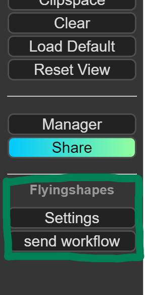
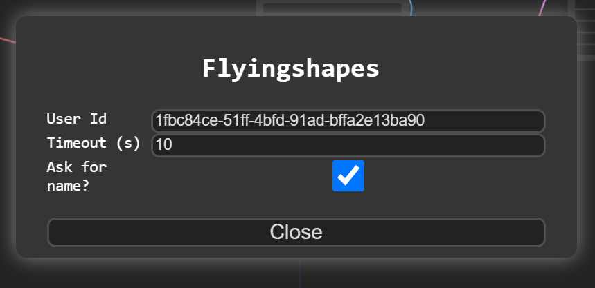
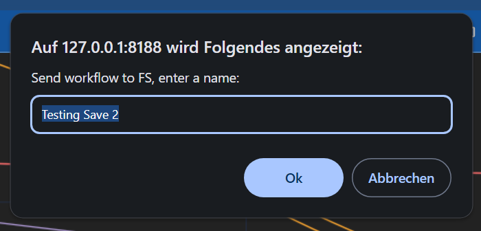

# ComfyUi-FS-extension

**ComfyUi-FS-extension** is an extension that enabled seamless interaction between Flyingshapes and the ComfyUi web-ui.


## Installation

Manual installation: 
```
cd /your_comfy_path/ComfyUi/custom_nodes
git clone https://pubgit.flyingshapes.com/flyingshapes/comfyui-fs-extension.git
```
Then restart ComfyUI

## Setup

You have to set up Flyingshapes as well as ComfyUi in order 

### Flyingshapes

1. start Flyingshapes
2. ensure that Flyingshapes can connect to the ComfyUi instance 
2. open a Project and the AI-Panel


### ComfyUi

If the extension is installed correctly, the section highlighted in green is added to the menu-panel. 

   

Here you have 2 Buttons:

1. Settings

   

   In order to set up ComfyUi with Flyingshapes, you need to enter your Flyingshapes UserId here.  
   Additionally you can specify a Timeout - this determines How long comfy will wait for
   Flyingshapes to provide input such as Screenshot data.

   When the "Ask for name" Option is enabled, comfy will prompt you to name your work flow when you click "send workflow"
   Otherwise, the workflow is sent without further delay.

   If the setup was successful, then in order to have Flyingshapes and ComfyUi to interact, you need to

2. send workflow


   

## Nodes

TODO: add Node description

